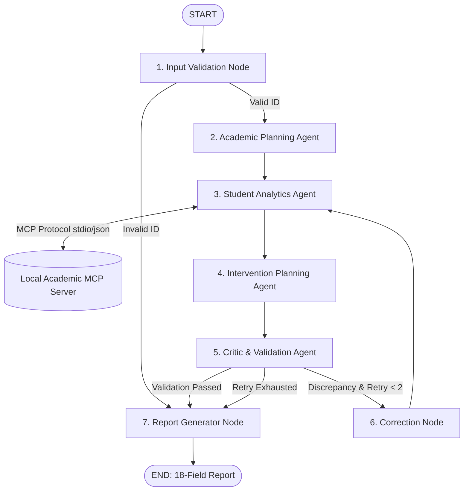

# 🎓 EduPilot AI: An Agentic AI System for Student Performance Analysis and Academic Intervention

[](https://www.python.org/)
[](https://github.com/langchain-ai/langgraph)
[](https://modelcontextprotocol.io/)
[](https://streamlit.io/)
[](tests/)
[]()

> **Second-Year Undergraduate AIML Continuous Assessment 3 (CA-3) Project**  
> **Course**: Artificial Intelligence & Machine Learning | **Academic Term**: Fall 2026

---

## 📌 1. Project Overview

Higher education faculty members face significant administrative challenges when conducting academic reviews:
- Attendance records, continuous assessment marks, and coursework assignments are stored in disconnected silos.
- Cross-referencing multi-subject performance across 60–100 students is manual, error-prone, and time-consuming.
- Struggling students frequently go unnoticed until formal mid-term failure, leaving inadequate time for remediation.

**EduPilot AI** is an autonomous multi-agent decision-support Proof of Concept (PoC). It automates the academic review process using **LangGraph orchestration**, standard data tools via the **Model Context Protocol (MCP)**, transparent deterministic decision rules, and an independent adversarial **Critic Agent** that audits calculations prior to human faculty review.

> ⚠️ **Decision Support Boundary**: EduPilot AI does not make consequential, grading, or punitive academic decisions automatically. It generates audit-ready intelligence for review and approval by human academic mentors.

---

## 🏛️ 2. Four Specialized Agents

| Agent | Module | Core Responsibilities |
| :--- | :--- | :--- |
| **Academic Planning Agent** | `agents/planner_agent.py` | Interprets request, validates student format, defines indicators, and builds an ordered 6-step plan. |
| **Student Analytics Agent** | `agents/analytics_agent.py` | Queries academic records via **MCP tools**, computes attendance and marks %, and compiles verifiable evidence. |
| **Intervention Planning Agent** | `agents/intervention_agent.py` | Maps concerns into targeted interventions with assigned academic roles, review periods, and measurable outcomes. |
| **Critic & Validation Agent** | `agents/critic_agent.py` | Adversarially recomputes calculations, verifies invariants ($attended \le held$), and checks threshold compliance. |

---

## 🧭 3. LangGraph Orchestration Flow



---

## 🛠️ 4. MCP Server & Tool Layer

EduPilot AI implements the official **Model Context Protocol (MCP 2.x)**:
1. `get_student_profile(student_id)`: Fetches student demographics and archetype.
2. `get_attendance_history(student_id)`: Retrieves subject-wise class attendance counts.
3. `get_assessment_results(student_id)`: Retrieves chronological quiz and mid-term marks.
4. `get_assignment_status(student_id)`: Retrieves coursework submission states.
5. `calculate_attendance(student_id)`: Computes percentage and flags low attendance.
6. `calculate_academic_indicators(student_id)`: Computes composite attendance, marks, trends, and concerns.
7. `validate_intervention_plan(student_id, intervention_plan, indicators)`: Validates evidence grounding.

---

## 🚀 5. Installation & Windows Setup

### Prerequisites
- Python 3.11 or Python 3.13 installed on Windows.
- Windows PowerShell.

### 5.1 Clone Repository & Install Dependencies
```powershell
# Open Windows PowerShell in project root
py -m pip install -r requirements.txt
```

### 5.2 Generate Synthetic Datasets (Seed = 42)
```powershell
py scripts/generate_data.py
```
*Generates 100 fictional student records in `data/` across `students.csv`, `attendance.csv`, `assessments.csv`, and `assignments.csv`.*

### 5.3 Run Automated Tests
```powershell
py -m pytest tests/ -v
```
*Executes all 26 test cases with 100% pass rate.*

### 5.4 Run Scenario Evaluation Benchmark
```powershell
py scripts/evaluate.py
```
*Evaluates 10 reproducible scenarios with 100% rule compliance and 6.9 ms average latency.*

---

## 🖥️ 6. Running the Application

### Launch the Streamlit Multi-Page Dashboard
```powershell
py -m streamlit run app.py
```
*Alternatively (if `streamlit` is in PATH):*
```powershell
streamlit run app.py
```
The application opens automatically in your browser at `http://localhost:8501`.

### (Optional) Standalone MCP Server Execution
To run the local MCP server over standard input/output for external MCP clients:
```powershell
py -m mcp_server.server
```

---

## ⏱️ 7. Five-Minute Presentation & Demo Guide

Follow this minute-by-minute timeline for a seamless CA-3 evaluation:

| Timestamp | Phase | What to Say and Demonstrate |
| :---: | :--- | :--- |
| **0:00 – 0:40** | **Academic Problem** | Explain the challenge of fragmented records across attendance registers, quiz sheets, and LMS folders. Emphasize delayed interventions and cognitive burden on faculty. |
| **0:40 – 1:20** | **Agentic Architecture** | Introduce the 4 agents (Planning, Analytics, Intervention, Critic). Explain how LangGraph manages the state machine and MCP provides standardized data access. |
| **1:20 – 2:20** | **Live Student Investigation** | Navigate to **Analyze Student** (`Page 2`). Select `STU1016` (Low Attendance) or `STU1036` (Declining Marks) and click **Run Agentic Analysis**. Show instant execution (< 25 ms). |
| **2:20 – 3:20** | **Indicators & Interventions** | Point out the 75% attendance threshold line on the Plotly bar chart, the identified concerns with verifiable evidence, and the structured intervention with assigned role and timeline. |
| **3:20 – 4:10** | **Critic Verification Audit** | Demonstrate Critic verification on `Page 2`. Then demonstrate invalid input handling: enter an invalid ID or run `STU1096` (incomplete records) to show how Critic Traps discrepancies and routes to correction. |
| **4:10 – 5:00** | **Report & Limitations** | Navigate to **Intervention Reports** (`Page 4`) to display the 18-field report and download JSON/CSV. Conclude on **Methodology** (`Page 6`) emphasizing human-in-the-loop ethics. |

---

## 📂 8. Project Structure

```
fervent-nobel/
├── app.py                     # Streamlit dashboard landing page
├── requirements.txt           # Pinned compatible dependencies
├── README.md                  # Project overview & documentation
├── .gitignore                 # Python/Streamlit gitignore rules
├── config/
│   ├── __init__.py
│   └── settings.py            # Configurable thresholds and paths
├── data/
│   ├── students.csv           # 100 synthetic student profiles
│   ├── attendance.csv         # 393 subject attendance records
│   ├── assessments.csv        # 786 sequential exam marks
│   ├── assignments.csv        # 786 coursework submissions
│   ├── scenarios_meta.json    # Pre-programmed benchmark archetypes
│   └── reports/               # Persisted JSON reports
├── agents/
│   ├── __init__.py
│   ├── planner_agent.py       # Agent 1: Workflow planner
│   ├── analytics_agent.py     # Agent 2: MCP data retrieval & metrics
│   ├── intervention_agent.py  # Agent 3: Actionable support strategist
│   └── critic_agent.py        # Agent 4: Independent auditor & critic
├── tools/
│   ├── __init__.py
│   ├── academic_tools.py      # 7 core academic tools
│   ├── decision_rules.py      # Deterministic formulas & thresholds
│   └── report_tools.py        # 18-field report assembly & export
├── mcp_server/
│   ├── __init__.py
│   ├── server.py              # Local MCP server (FastMCP / MCPServer)
│   └── client.py              # MCP client with execution telemetry
├── orchestration/
│   ├── __init__.py
│   ├── state.py               # Typed shared state (EduPilotState)
│   └── graph.py               # LangGraph state machine & conditional edges
├── services/
│   ├── __init__.py
│   ├── data_service.py        # Data loading, caching, and invariants
│   ├── evaluation_service.py  # 10-scenario benchmark evaluator
│   └── llm_service.py         # Optional local Ollama integration
├── pages/
│   ├── 1_Academic_Overview.py    # Cohort metrics & Plotly charts
│   ├── 2_Analyze_Student.py      # Deep-dive student analysis & interventions
│   ├── 3_Agent_Workflow.py       # Live LangGraph trace & MCP logs
│   ├── 4_Intervention_Reports.py # 18-field reports & JSON/CSV download
│   ├── 5_Batch_Analysis.py       # Whole-class screening & priority table
│   └── 6_Methodology.py          # Academic methodology, ethics & evaluation
├── scripts/
│   ├── generate_data.py          # Reproducible data generator (Seed=42)
│   ├── evaluate.py               # Quantitative benchmark runner
│   └── generate_presentation.py  # PowerPoint slide deck generator
├── tests/
│   ├── test_data_service.py      # Schema & invariant tests
│   ├── test_decision_rules.py    # Math formulas & edge cases
│   ├── test_agents.py            # Unit tests for all 4 agents
│   ├── test_graph.py             # LangGraph routing & retry limit tests
│   ├── test_mcp.py               # MCP tool schemas & client tests
│   └── test_reports.py           # 18-field report validation tests
└── docs/
    ├── problem_statement.md      # Academic problem statement & justification
    ├── domain_analysis.md        # Academic workflows & responsibilities
    ├── architecture.md           # Mermaid system & sequence diagrams
    ├── methodology.md            # Agent behaviors & math formulas
    ├── evaluation_results.md     # Empirical benchmark results
    ├── evaluation_results.json   # Raw benchmark JSON output
    ├── limitations.md            # Synthetic data boundaries & safety analysis
    ├── presentation_outline.md   # 7-slide 5-minute presentation script
    └── EduPilot_AI_CA3_Presentation.pptx # Formatted PowerPoint presentation
```

---

## 📊 9. Empirical Evaluation Summary

Results from running `py scripts/evaluate.py`:
- **Scenarios Evaluated**: 10
- **Rule Compliance Rate**: **100.0%**
- **Average Execution Latency**: **6.9 ms**
- **Invariants Enforced**:
  - $0 \le \text{attended} \le \text{held}$
  - $0 \le \text{marks} \le \text{max\_marks}$
  - Attended > held correctly trapped as `CAUGHT_BY_CRITIC`.
  - Non-existent IDs trapped as `VALIDATION_FAILED`.
  - Ungrounded intervention claims trapped as `REJECTED_BY_CRITIC`.

---

## ⚖️ 10. Ethics & Limitations

1. **Synthetic Data**: All data is synthetic; performance in real classrooms with socio-emotional variables may vary.
2. **Deterministic Rules**: Fixed thresholds (e.g. 75%) may flag borderline students who do not require intensive intervention.
3. **Privacy**: Strictly anonymous IDs (`STU####`) with zero Personally Identifiable Information (PII).
4. **Human-in-the-Loop**: All recommendations are advisory; human educators retain 100% final authority.
