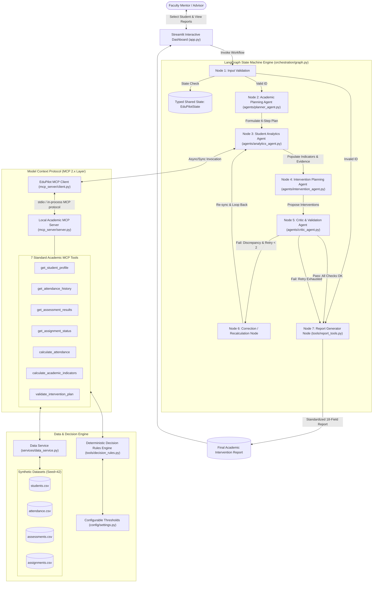
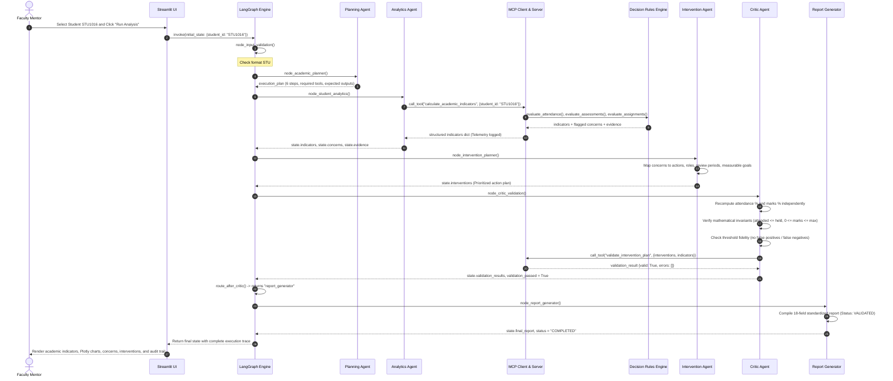

# EduPilot AI: Architecture Specification & System Design

This document details the multi-agent system architecture, data flow, tool interfaces,
and orchestration state machine implemented in **EduPilot AI**.

---

## 1. System Architecture Diagram



---

## 2. Theoretical Grounding: Russell & Norvig AI Agent Taxonomy

EduPilot AI grounds its multi-agent architecture in the classical taxonomy defined by Stuart Russell and Peter Norvig (*Artificial Intelligence: A Modern Approach*, 4th Edition, Chapter 2). Each agent embodies a distinct theoretical agent paradigm:

| Agent | Taxonomy Classification | Theoretical Mechanism | PEAS Sensor / Actuator Profile |
| :--- | :--- | :--- | :--- |
| **Agent 1: Academic Planning Agent** | **Goal-Based Agent** | Combines goal descriptions $G = \text{Objective}(\text{Student ID})$ with action predictions to formulate an ordered 6-step plan and indicator dependencies. | **S**: Student ID, Objective<br/>**A**: Ordered 6-step plan in shared state |
| **Agent 2: Student Analytics Agent** | **Model-Based Reflex Agent** | Maintains internal longitudinal state across sequential assessments and fires condition-action reflex rules ($P \to A$). | **S**: Academic MCP tool JSON payloads<br/>**A**: Indicators, concerns, evidence |
| **Agent 3: Intervention Planning Agent** | **Utility-Based Agent** | Maximizes pedagogical recovery utility function $U(A, S, R)$ to trade off intervention intensity against student and faculty burden. | **S**: Flagged concerns & evidence<br/>**A**: Prioritized intervention roadmaps |
| **Agent 4: Critic & Validation Agent** | **Learning & Verification Agent** | Features a distinct Critic component asserting invariants, generating error signals that trigger the Correction Node for bounded retries. | **S**: Recomputed values, raw data assertions<br/>**A**: Verification status, routing signal |

---

## 3. Sequence Diagram: Single Student Academic Investigation

The following sequence diagram illustrates the lifecycle of analyzing a student (e.g., `STU1016`):



---

## 3. Shared State Schema (`EduPilotState`)

The shared state passed through all nodes is strictly typed as follows:

```python
class EduPilotState(TypedDict):
    request_id: str
    student_id: str
    batch_ids: Optional[List[str]]
    analysis_mode: str  # "single" | "batch"
    analysis_objective: str

    execution_plan: Dict[str, Any]       # Steps generated by Planning Agent
    profile: Dict[str, Any]              # Student metadata
    indicators: Dict[str, Any]           # Calculated attendance, marks, assignments
    concerns: List[Dict[str, Any]]       # Concerns flagged by decision rules
    evidence: Dict[str, Any]             # Traceable numerical findings
    support_priority: str                # HIGH | MEDIUM | LOW | NONE

    interventions: List[Dict[str, Any]]  # Actions, roles, review periods, goals
    validation_results: Dict[str, Any]   # Critic verification report
    validation_passed: bool              # Critic pass/fail boolean flag
    retry_count: int                     # Active correction retry counter
    max_retries: int                     # Bounded limit (default 2)

    execution_trace: List[Dict[str, Any]] # Audit event log per node
    mcp_tool_calls: List[Dict[str, Any]]  # Telemetry log of MCP tool invocations
    final_report: Dict[str, Any]         # Standard 18-field report
    status: str                          # Workflow lifecycle status
    errors: List[str]                    # Trapped error messages
```

---

## 4. MCP Communication Architecture

The Model Context Protocol establishes a clean client-server architecture:
- **Server (`mcp_server/server.py`)**: Built on `mcp.server.mcpserver.MCPServer`. Standardizes data retrieval and calculation tools into registered tool schemas with defined inputs and JSON outputs.
- **Client (`mcp_server/client.py`)**: The `EduPilotMCPClient` provides both synchronous and asynchronous invocations, validates arguments, logs duration (latency in milliseconds), logs status (`SUCCESS` / `ERROR`), and records summary previews for execution traceability.
- **Standalone Transport**: The MCP server can also be launched independently via standard I/O:
  ```powershell
  py -m mcp_server.server
  ```
  allowing any external MCP-compliant host to query EduPilot academic tools.
