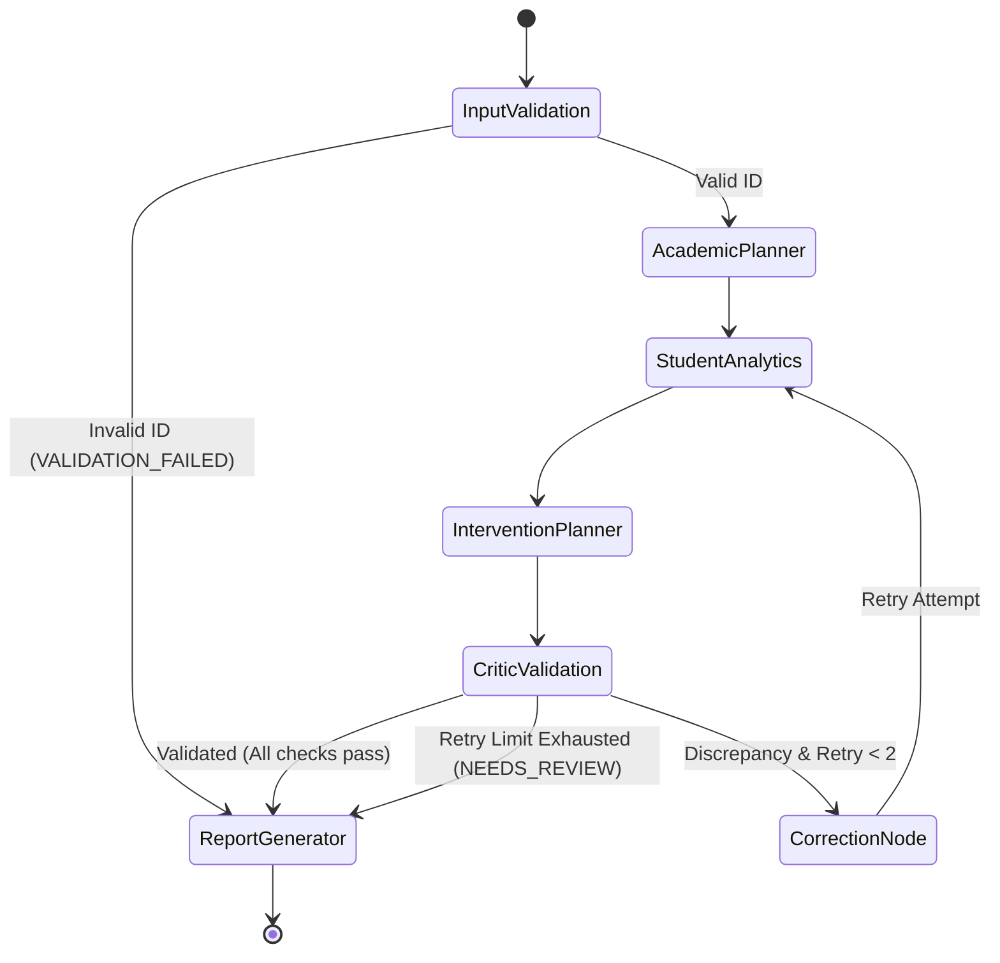

# EduPilot AI: Methodology & Engineering Implementation

**Academic Project**: Second-Year Undergraduate AIML CA-3  
**Frameworks**: LangGraph, Model Context Protocol (MCP 2.x), Streamlit, Pandas, Plotly, Pytest  

---

## 1. Multi-Agent System Roles & AI Taxonomy (Russell & Norvig)

EduPilot AI decomposes academic screening into four specialized agents, each grounded in classical AI agent taxonomy:

### 1.1 Academic Planning Agent — Goal-Based Agent (`agents/planner_agent.py`)
- **Agent Paradigm**: **Goal-Based Agent** (Russell & Norvig, Ch. 2). Formulates sub-goals $A = [a_1, \dots, a_6]$ to achieve the analysis objective.
- **Input**: Student ID string (e.g. `STU1016`) and analysis objective.
- **Processing**:
  1. Validates ID format via regex matching (`^STU\d{3,6}$`).
  2. Queries dataset registry to ensure existence.
  3. Formulates a typed 6-step execution plan outlining required tools, responsible agents, and expected outputs.
- **Output**: Typed execution plan (`state.execution_plan`).

### 1.2 Student Analytics Agent — Model-Based Reflex Agent (`agents/analytics_agent.py`)
- **Agent Paradigm**: **Model-Based Reflex Agent with Internal State**. Maintains historical multi-term state across assessments and evaluates condition-action rules ($P \to A$).
- **Input**: Verified student identifier.
- **Processing**:
  1. Invokes the MCP tool `calculate_academic_indicators`.
  2. Ingests raw subject attendance, chronological assessment scores, and assignment submission states.
  3. Evaluates configured rules for attendance breaches ($<75\%$), failing assessment marks ($<40\%$), score decline ($\ge 15\%$ pts), and missing assignments.
  4. Synthesizes a verifiable evidence log linking every flagged concern directly to numerical records.
- **Output**: Aggregated indicators, flagged concerns list, and evidence dictionary.

### 1.3 Intervention Planning Agent — Utility-Based Agent (`agents/intervention_agent.py`)
- **Agent Paradigm**: **Utility-Based Agent**. Maximizes pedagogical recovery utility function $U(A, S, R)$ to trade off support intensity against student burden.
- **Input**: Flagged concerns, academic indicators, composite support priority.
- **Processing**:
  1. Maps concerns to standardized pedagogical interventions using transparent decision tables.
  2. Assigns specific academic roles (`Course Instructor`, `Faculty Mentor`, `Department Coordinator`).
  3. Designates actionable review periods (`1 Week`, `2 Weeks`, `3 Weeks`, `End of Term`).
  4. Formulates measurable, objective targets (e.g., *"Attend $\ge 85\%$ of upcoming lectures in CS201 to raise cumulative attendance towards 75%"*).
  5. For high-priority or multi-concern students, synthesizes an overarching *Coordinated Multi-Disciplinary Advisement* intervention.
- **Output**: Structured list of actionable intervention objects.

### 1.4 Critic and Validation Agent — Learning & Verification Agent (`agents/critic_agent.py`)
- **Agent Paradigm**: **Learning & Verification Agent with Critic Component**. Features an adversarial Critic element asserting invariants, feeding error signals to the Correction Node for bounded retries.
- **Input**: Complete analysis state, indicators, interventions, and raw records.
- **Processing**:
  1. **Independent Attendance Recomputation**: Re-evaluates $\frac{\text{attended}}{\text{held}} \times 100$ and asserts $\text{attended} \le \text{held}$.
  2. **Independent Assessment Recomputation**: Re-evaluates $\frac{\text{marks}}{\text{max}} \times 100$ and asserts $0 \le \text{marks} \le \text{max}$.
  3. **Threshold Fidelity Check**: Asserts that no false positives or false negatives occurred against the active threshold settings.
  4. **Intervention Grounding Audit**: Asserts that every proposed intervention addresses a real identified concern and has non-empty role, review period, and measurable goal fields.
- **Output**: Structured audit report (`state.validation_results`) with boolean `validation_passed`.

---

## 2. LangGraph State Machine & Conditional Edges

EduPilot AI uses **LangGraph** (`langgraph>=0.2.0`) to orchestrate agents via a compiled `StateGraph`:



### 2.1 State Persistence and Audit Logging
At every node transition, an audit entry is appended to `execution_trace`:
```python
{
    "step_number": int,
    "node_name": str,
    "timestamp": ISO8601_str,
    "duration_ms": float,
    "status": "SUCCESS" | "FAILED" | "RETRY" | "PASSED",
    "summary": str,
    "details": dict
}
```
This execution trace drives the live observability interface in **Page 3: Agent Workflow**.

---

## 3. Standardized MCP Tool Integration

EduPilot AI implements the **Model Context Protocol (MCP 2.x)**:
- **Server Module**: `mcp_server/server.py` defines `mcp_server = MCPServer("edupilot-academic-server")`.
- **Registered Tools**:
  1. `get_student_profile(student_id)`
  2. `get_attendance_history(student_id)`
  3. `get_assessment_results(student_id)`
  4. `get_assignment_status(student_id)`
  5. `calculate_attendance(student_id)`
  6. `calculate_academic_indicators(student_id)`
  7. `validate_intervention_plan(student_id, intervention_plan_json, indicators_json)`
- **Telemetry Logging**: `mcp_server/client.py` logs tool name, arguments, latency in ms, status (`SUCCESS` / `ERROR`), and result summaries.

---

## 4. Deterministic Decision Rules & Mathematical Formulas

All analytical calculations are transparent and deterministic:

### 4.1 Attendance Percentage
$$\text{Attendance (\\%)} = \frac{\text{classes\_attended}}{\text{classes\_held}} \times 100$$
- Invariant: $0 \le \text{classes\_attended} \le \text{classes\_held}$
- Division by Zero Protection: If $\text{classes\_held} = 0$, returns $0.0\%$.

### 4.2 Assessment Percentage
$$\text{Performance (\\%)} = \frac{\text{marks\_obtained}}{\text{maximum\_marks}} \times 100$$
- Invariant: $0.0 \le \text{marks\_obtained} \le \text{maximum\_marks}$
- Constraint: $\text{maximum\_marks} > 0$

### 4.3 Performance Trajectory (Score Delta)
$$\Delta = \text{Score}_{\text{Quiz 1}} - \text{Score}_{\text{Mid-Term Exam}}$$
- Trigger: If $\Delta \ge 15.0\% \text{ points}$, flags `PERFORMANCE_DECLINE`.

### 4.4 Assignment Status
$$\text{Missing Count} = \sum [\text{status} \in \{\text{MISSING}, \text{PENDING}\}]$$
- Trigger: If $\text{Missing Count} > 0$, flags `ASSIGNMENT_INCOMPLETE`.

---

## 5. Synthetic Datasets & Reproducibility

Synthetic data is deterministically generated by `scripts/generate_data.py` using fixed random seed `SEED = 42`:
- `data/students.csv`: 100 synthetic students (`STU1001` to `STU1100`) across B.Tech AIML, CSE, and Data Science.
- `data/attendance.csv`: 393 records across 4 core engineering subjects.
- `data/assessments.csv`: 786 sequential assessment records (Quiz 1 and Mid-Term Exam).
- `data/assignments.csv`: 786 assignment submissions.
- `data/scenarios_meta.json`: Pre-programmed archetypes for automated benchmarking.

---

## 6. Comprehensive Testing & Validation Strategy

The project includes an automated **pytest** suite (`tests/`):
- `tests/test_data_service.py`: Dataset schema validation, loading, invariants.
- `tests/test_decision_rules.py`: Mathematical rules, boundary conditions, zero division, invalid inputs.
- `tests/test_agents.py`: Unit verification of each of the 4 specialized agents.
- `tests/test_graph.py`: LangGraph structure, execution order, conditional routing, batch analysis.
- `tests/test_mcp.py`: MCP tool registrations, client invocations, telemetry logging.
- `tests/test_reports.py`: 18-field report completeness, JSON serialization, CSV export.
